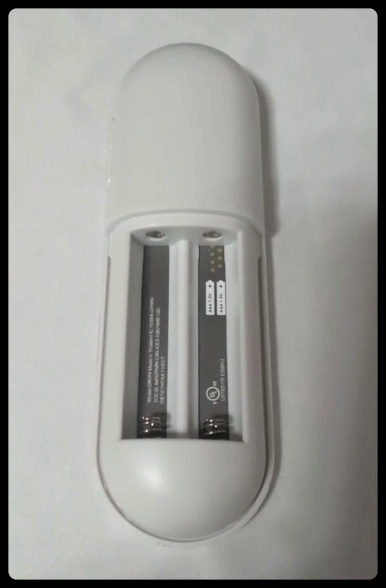

# gvtv-remote

Map a Bluetooth HID remote (tested with the **Chromecast Voice Remote**, `18d1:9450`)
to macOS actions, with an **Fn/Globe cloud key** for voice input and an optional
**remote-microphone → virtual audio device** bridge.

- **Platform:** macOS 13+ (Intel / Apple Silicon). **iOS, Windows and Linux are not supported.**
- **Remote:** any remote macOS exposes as a HID keyboard / Consumer Control device.
  **Full support (voice key + microphone) is validated only on the model in the photo:
  Chromecast with Google TV Voice Remote (2020), G9N9N, VID:PID `18d1:9450`.**
  Other Google/Chromecast remotes look similar but differ; basic buttons may map, voice and
  microphone are not guaranteed.


- **Scope note:** the voice key of the Chromecast remote is not a HID report; it is a BLE
  GATT indication (`0x003F`). The app reads it from the Bluetooth log. Subscribing to the
  same GATT characteristic with another tool will hide those log lines — toggle Bluetooth
  off/on to recover.

## Quick start

```bash
git clone https://github.com/Scu9277/gvtv-remote.git gvtv-remote
cd gvtv-remote
./scripts/install-app.sh          # build + install the native app
./scripts/install-app-login.sh    # optional: open at login
```

Grant **Input Monitoring** and **Accessibility** to “Google TV Remote” in
System Settings → Privacy & Security. Then press the remote.

Optional remote microphone (Chromecast/ATVV remotes only):

```bash
./scripts/install-blackhole.sh
./scripts/install-mic.sh
# select "BlackHole 2ch" as the microphone in your voice input app
```

Full manual (Chinese): [docs/USAGE.md](docs/USAGE.md). Architecture and button table:
[README.md](README.md). Third-party credits: [THIRD_PARTY.md](THIRD_PARTY.md).

License: MIT (our code). Optional BlackHole driver is GPL-3.0 and installed separately.

Not affiliated with Google. Google TV and Chromecast are trademarks of Google LLC.
