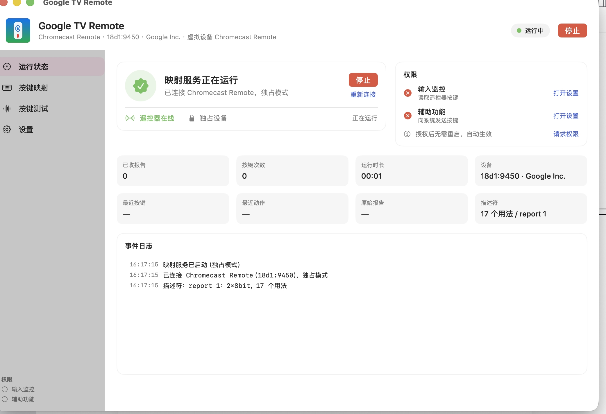

# gvtv-remote

把 **Google TV / Chromecast 蓝牙语音遥控器**（`Chromecast Remote`，VID:PID `18d1:9450`）
接成 macOS 的输入设备：方向键、确定、返回、首页、音量、静音、播放/暂停、YouTube、
Netflix 全部映射成系统动作；**语音键（Assistant）映射成 Fn / Globe 键**，按下即触发
macOS 听写（云键），说完自动结束录音。

提供两种形态：**原生 macOS App**（推荐，双击即用）和纯 Python 命令行工具；
不依赖 PyObjC、Karabiner 或任何后台商业软件。

> **支持范围**：macOS 13+（Intel / Apple Silicon）＋ 任何能被 macOS 识别为 HID 键盘 /
> Consumer Control 的蓝牙遥控器（已实测 Chromecast Voice Remote `18d1:9450`）。
> **iPhone / iPad 不支持**：iOS 不允许第三方 App 做系统级按键注入，遥控器可配对成键盘，
> 但本软件无法在 iOS 上运行。详见 [通用手册](docs/USAGE.md)。
>
> 本项目与 Google 无关联；Google TV、Chromecast 是 Google LLC 的商标。

---

## 原生 App（推荐）

双击即用的 macOS 应用：**配好一次权限，按遥控器就工作**。原生 SwiftUI，无第三方依赖。



```bash
./scripts/install-app.sh      # 构建 + 安装到 /Applications + 打开
```

首次打开后，在「系统设置 → 隐私与安全性」里勾选 **Google TV Remote**：

| 权限 | 用途 |
| --- | --- |
| 输入监控 | 读取遥控器按键 |
| 辅助功能 | 向系统发送按键 |

授权后 App 会自动重连（窗口左下角两个圆点变绿即就绪）；若仍无反应，重启一次 App。
`./scripts/install-app.sh` 会同时把 App 安装到 `/Applications`。

### 功能

* **运行状态**：运行中 / 已停止、设备在线、独占模式、报告数、按键次数、运行时长、
  最近按键、最近动作、原始报告、事件日志；菜单栏也有图标常驻。
* **按键映射**：左侧列出遥控器 17 个按键，右侧编辑动作；支持键盘快捷键、媒体键、
  打开 App、打开网址、Shell、输入文本、语音键；支持「录制」组合键，配置实时保存。
* **语音悬浮窗**：按下语音键时出现「正在听写…」浮窗（不抢焦点），命名沿用虚拟设备名。
* **按键测试**：实时显示遥控器按下的按键与解析结果；内置 6 个组合键预设
  （聚焦搜索、切换 App、锁屏、区域截图、强制退出、调度中心），可录制任意组合并
  「发送到系统」验证权限链路；还有音量/静音/播放暂停与 Fn 测试。
* **可扩展**：侧边栏分页 + 数据驱动映射；「+」可添加任意 HID usage 的自定义按键。
* **命名**：虚拟窗口/设备默认沿用设备原名 **Chromecast Remote**（Google Inc. /
  18d1:9450），可在「设置 → 虚拟窗口 / 设备命名」修改。

App 与命令行共用同一份配置：`~/.config/gvtv-remote/mapping.json`。
两者不要同时运行（会争抢独占设备）；如果装过命令行 LaunchAgent，先
`./scripts/uninstall.sh`。

> App 使用 ad-hoc 签名：重新构建/安装后系统可能要求重新授权一次；
> 请把 App 固定放在 `/Applications` 使用。

## 1. 这只遥控器在 macOS 上是什么

参考环境（macOS 26.5.1，Apple Silicon）：

```text
设备      : Chromecast Remote
VID:PID   : 18d1:9450          (Google Inc.)
传输      : Bluetooth Low Energy
用途页    : 0x0C / 0x01        (Consumer Control)
报告上限  : 3 字节
描述符    : 050c0901a10185010a9e0109cd0942094309440945094109e2
            0a21020a23020a240209e909ea0977097809790989150125
            11950275088100c0
```

它是一个 **Consumer Page 的数组型 HID 设备**：报告 ID 1，两个 8 bit 槽位，逻辑值 1..17
对应 17 个用法（usage）。按下时报告里写的是“第几个用法”，松开时写 0。所以系统把它
当成“键盘/媒体键”一类设备，但很多按键 macOS 并不认识——这正是需要映射的原因。

描述符解出来的 17 个用法：

| 报告值 | usage | 物理按键（实测） |
| --- | --- | --- |
| 1 | `0x19E` | 电源 |
| 2 | `0xCD` | 播放/暂停 |
| 3 | `0x42` | 方向上 |
| 4 | `0x43` | 方向下 |
| 5 | `0x44` | 方向左 |
| 6 | `0x45` | 方向右 |
| 7 | `0x41` | 确定 |
| 8 | `0xE2` | 静音 |
| 9 | `0x221` | 语音 Assistant |
| 10 | `0x223` | 首页 |
| 11 | `0x224` | 返回 |
| 12 | `0xE9` | 音量加 |
| 13 | `0xEA` | 音量减 |
| 14 | `0x77` | YouTube |
| 15 | `0x78` | Netflix |
| 16 | `0x79` | 未标注（待学习） |
| 17 | `0x89` | 输入源 |

> 物理按键对应关系来自对同款遥控器 8 字节按键报告的逆向记录
> （[ZSTDJan/windows-remote-mic-app](https://github.com/ZSTDJan/windows-remote-mic-app)
> 的 Chromecast 专项文档，按键码 `01/03/04/05/06/07/08/0A/0B/0C/0D/0E/0F/11` 与本机
> HID 数组下标 1:1 对齐），本机再用 IOKit 读出的描述符做了交叉验证。

---

## 2. 上游调研结论（为什么是本地实现）

| 项目 | 平台 | 能否直接用 |
| --- | --- | --- |
| [Karabiner-Elements](https://github.com/pqrs-org/Karabiner-Elements) | macOS | 通用改键器，但它的 `consumer_key_code` 只认识标准媒体键，接不住这块遥控器的数组报告（值 1..17 → 自定义 usage），需要写自定义驱动 |
| [ZSTDJan/windows-remote-mic-app](https://github.com/ZSTDJan/windows-remote-mic-app) | Windows | 明确支持这只遥控器（含语音键按住/开关两种模式），但它是 Windows + VB-CABLE 方案，macOS 跑不了；按键表是重要参考 |
| [LiveNL/ack05d](https://github.com/LiveNL/ack05d) | macOS | 另一款 BLE 遥控器的 userspace 驱动，架构参考（IOHID + 事件合成） |
| `hidutil`（系统自带） | macOS | 只能重映射 **键盘页 0x07** 的用法，对 Consumer 数组无效 |

GitHub 上没有“这款遥控器 + macOS 按键映射”的现成项目，所以本仓库按
`IOHIDManager 读取 → 描述符解码 → CGEvent 合成` 的路线实现，直接在本机跑。

---

## 3. 工作原理

```text
BLE 遥控器
   │  HID report (report ID 1, 2×8bit array)
   ▼
IOHIDManager ── 按 VID/PID 匹配，默认“独占”打开（系统不再收到原始按键）
   │
   ▼
Report Descriptor 解析 ── 值 1..17 → usage 0x19E/0x42/…/0x89
   │
   ▼
按键状态差分（按下 / 松开，按住不重复触发）
   │
   ├──▶ CGEvent 键盘事件（方向键、Return、Escape、Ctrl+Up…）
   ├──▶ NX_SYSDEFINED 媒体键（音量、静音、播放/暂停）
   └──▶ Fn / Globe flagsChanged（语音键 → macOS 听写）
```

关键点：

* **独占模式**：`IOHIDManagerOpen(..., kIOHIDOptionsTypeSeizeDevice)` 成功后，macOS 的
  默认驱动不再处理这颗遥控器，因此不会出现“系统动作 + 自定义动作”双触发。若独占失败
  会自动退回共享模式并在日志里提示。
* **不猜键码**：描述符是运行时从设备读出来的，值 → usage 的映射由描述符决定；换固件
  只要描述符还兼容就能工作。
* **按住不连发**：报告是状态快照，只有“新按下”的键才触发动作。

---

## 4. 快速开始

```bash
git clone https://github.com/Scu9277/gvtv-remote.git ~/gvtv-remote
cd ~/gvtv-remote

./scripts/install-app.sh     # 推荐：构建并安装原生 App
# 或使用命令行：
./bin/gvtv-remote doctor     # 体检：权限 / 设备 / 描述符 / 配置
./bin/gvtv-remote run        # 启动映射（Ctrl-C 退出）
```

第一次运行前需要给足两个权限（见下一节），否则会看到：

```text
辅助功能: ✗   输入监控: ✗
⚠️ 没有辅助功能（Accessibility）权限，合成按键会被系统忽略。
```

### 先用 dry-run 确认按键能收到

```bash
./bin/gvtv-remote sniff --seconds 30
```

按遥控器上的键，终端会实时打印报告和解析结果，例如：

```text
report 1: 09 00  -> c:0x221 语音 Assistant
report 1: 00 00  -> -
```

`sniff` 是共享模式，不抢占系统行为，可以随时安全运行。

---

## 5. 权限（macOS 必做）

| 权限 | 用途 | 在哪里开 |
| --- | --- | --- |
| **输入监控**（Input Monitoring） | 读取遥控器 HID 报告 | 系统设置 → 隐私与安全性 → 输入监控 |
| **辅助功能**（Accessibility） | 合成键盘/媒体/Fn 事件 | 系统设置 → 隐私与安全性 → 辅助功能 |

你运行程序的“身份”决定了要勾选谁：

* **在终端里直接跑**：勾选你用的终端（Terminal / iTerm / VS Code）。
* **用 `scripts/install.sh` 装成 LaunchAgent**：勾选 `/usr/bin/python3`
  （点 `+`，按 `Cmd+Shift+G`，输入 `/usr/bin/python3`）。
* 用 `scripts/run.command` 双击运行：勾选 Terminal（它会在终端窗口里跑）。

改完权限后，LaunchAgent 方式需要重启一次：

```bash
launchctl kickstart -k gui/$(id -u)/com.gvtv.remote
```

权限状态随时可以查：

```bash
./bin/gvtv-remote permissions
./bin/gvtv-remote permissions --open   # 直接打开辅助功能面板
```

> 说明：`IOHIDManagerOpen` 本身不需要权限也能成功，但没有“输入监控”时收不到按键
> 报告；没有“辅助功能”时 `CGEventPost` 会被系统静默丢弃。`doctor` 会分别报告这两项。

---

## 6. 默认键位

配置：`~/.config/gvtv-remote/mapping.json`（不存在时用仓库里的 `config/mapping.json`）。

| 遥控器按键 | macOS 动作 |
| --- | --- |
| 方向上/下/左/右 | ↑ / ↓ / ← / → |
| 确定 | Return |
| 返回 | Escape |
| 首页 | `Ctrl+↑`（调度中心） |
| 语音 Assistant | **Fn（云键，见第 7 节）** |
| 音量加 / 减 | 系统音量 + / − |
| 静音 | 系统静音 |
| 播放/暂停 | 播放/暂停 |
| 电源 | `Ctrl+Cmd+Q`（锁屏） |
| YouTube | 打开 <https://www.youtube.com> |
| Netflix | 打开 <https://www.netflix.com> |
| 输入源 | `Cmd+Tab`（切换 App） |
| 值 16（未知） | 无动作，待学习 |

查看当前映射：

```bash
./bin/gvtv-remote doctor
# 或
./bin/gvtv-remote buttons      # 只列设备支持的按键表
```

---

## 7. 语音键 = Fn / Globe 云键

语音键映射为 `"voice"` 动作。程序不会去碰遥控器的麦克风（那是 BLE 上另一条
ATVV/GATT 音频链路，macOS 不暴露给普通应用），而是**模拟键盘 Fn(Globe) 键**，
让 macOS 自己的听写（Dictation）接管：系统用 Mac 的麦克风做云端识别，说完自动断句、
结束录音并把文字上屏。

### 7.1 先设置系统听写快捷键

系统设置 → 键盘：

1. 打开“听写”，选择语言；
2. 把“按下 🌐（Fn）键”设为 **“开始听写 / Start Dictation”**；
   或使用听写快捷键里的 **“按 Fn（Globe）键”**（有的版本是“按两次 Fn”）。
   不同 macOS 版本入口略有差异（键盘 → 听写 / 键盘快捷键）。
3. 首次使用会下载语言模型，之后可离线识别。

### 7.2 三种触发方式

在 `voice.mode` 里选：

| 模式 | 行为 | 对应系统设置 |
| --- | --- | --- |
| `hold`（默认） | 按下发 Fn down，松开发 Fn up | “按住 Fn 听写” / “按一下 Fn” |
| `toggle` | 每次按下发一次 Fn 轻按，再按一次结束 | “按一下 Fn 开始/停止” |
| `double` | 每次按下连发两次 Fn | “按两次 Fn 开始听写” |

> 如果系统只支持“按两次 Fn”，也可以保持 `hold` 模式，**连续按两下遥控器语音键**：
> 两次按下/松开正好合成两次 Fn 敲击。

```json
"voice": {
  "button": "assistant",
  "mode": "hold",
  "max_session_s": 60,
  "release_delay_ms": 150,
  "end_actions": [],
  "disconnect_bluetooth": false,
  "bluetooth_address": ""
}
```

* `max_session_s`：保险丝。按住超过这个时间会强制发 Fn up 结束，避免一直录。
* `release_delay_ms`：松开后延迟多久执行收尾动作。
* `end_actions`：结束后的附加动作，比如 `["key:escape"]` 关掉听写浮窗、
  `["shell:afplay /System/Library/Sounds/Glass.aiff"]` 提示音。
* `disconnect_bluetooth`：**可选**。设为 `true` 且安装 `blueutil`
  （`brew install blueutil`）后，每次语音结束会断开 BLE 连接（“说完断开”）。
  默认关闭，因为断开后要等遥控器重新连接才能继续用。

### 7.3 单独测试 Fn

```bash
./bin/gvtv-remote test-fn
```

把光标放进任意输入框，执行后应看到听写浮窗（取决于系统快捷键设置）。

### 7.4 如果按语音键没有任何报告

用 `sniff` 确认。如果按语音键终端没有输出，说明这只遥控器把麦克风键只走厂商 GATT
通道（Windows 抓包文档里确实是 `0x003F` 控制属性），HID 不上报。此时可以：

```bash
# 把任意一个不常用的键（例如“输入源”）学成语音键
./bin/gvtv-remote learn --bind voice
```

按一下那个键即可，配置会立刻写入。

---


### 7.5 用遥控器自己的麦克风（可选）

遥控器的麦克风不是标准 USB 音频设备，声音走 BLE 的 ATVV 服务（GATT 0x003C，IMA/DVI ADPCM，
16 kHz）。macOS 不把它暴露成音频输入，所以本工程做了两件事：

1. 安装虚拟声卡 **BlackHole 2ch**（GPL-3.0，`scripts/install-blackhole.sh`），
   也可以运行 `scripts/create-gtv-device.sh` 复制成独立的 **Google TV 2ch**；
2. 后台桥 `tools/remote-mic` 从蓝牙日志里取出 0x003C 音频包，解码成 16 kHz PCM，写进
   Google TV 2ch 的输出端；输入法从它的输入端就能读到遥控器麦克风。

```bash
./scripts/install-blackhole.sh    # 只需一次
./scripts/install-mic.sh          # 构建并常驻（LaunchAgent: com.gvtv.remote-mic）
# 如创建了独立声卡：
GVTV_AUDIO_DEVICE="Google TV 2ch" ./scripts/install-mic.sh
```

然后在输入法/语音软件的「麦克风」里选择 **BlackHole 2ch**（或 **Google TV 2ch**），
**按住**遥控器语音键说话、松开结束。日志：`~/Library/Logs/RemoteMic.log`。

> **关键限制**：这套语音键检测依赖 bluetoothd 把未被订阅的 GATT indication 写进系统日志。
> 一旦有 CoreBluetooth 客户端订阅了遥控器的 ATVV 特征，日志就不再出现，语音键会“失灵”
> （其他 HID 按键不受影响）。此时把 Mac 蓝牙关掉再打开即可恢复。不要同时跑其它会订阅
> GATT 的程序。

## 8. 自定义映射

### 8.1 动作写法

`mapping` 的值可以是短字符串，也可以是对象：

```json
{
  "c:0x42": "key:cmd+shift+4",
  "c:0x223": "app:Safari",
  "c:0x77": "url:https://music.youtube.com",
  "c:0x89": "shell:open -a 'System Settings'",
  "c:0x79": { "type": "key", "key": "space", "modifiers": ["cmd"], "hold_ms": 40 },
  "c:0x221": "voice"
}
```

| 写法 | 含义 |
| --- | --- |
| `key:cmd+space` | 组合键；`hold=80` 可加在逗号后 |
| `media:play_pause` | 媒体键：`volume_up` `volume_down` `mute` `play_pause` `next` `previous` |
| `app:Safari` | `open -a Safari` |
| `url:https://…` | 用默认浏览器打开 |
| `shell:…` | `/bin/bash -lc` 执行 |
| `text:你好` | 直接输入字符串（Unicode） |
| `voice` | 语音键 / Fn 云键 |
| `none` | 什么都不做 |

### 8.2 按键 ID

* 规范 ID：`c:0x42`（Consumer 页）、`k:0x28`（Keyboard 页）
* 别名：`dpad_up` `dpad_down` `dpad_left` `dpad_right` `ok` `home` `back`
  `assistant` `mute` `volume_up` `volume_down` `play_pause` `power`
* 学习：`./bin/gvtv-remote learn`，按一下就知道 ID；加
  `--bind 'key:cmd+space'` 直接保存。

### 8.3 改完配置

`run` 进程会在设备重连时重新读取配置；最稳妥是 Ctrl-C 后重启，或
`launchctl kickstart -k gui/$(id -u)/com.gvtv.remote`。

---

## 9. 常驻运行

### 方式 A：终端窗口（简单，推荐先用）

```bash
./scripts/run.command
# 或
./bin/gvtv-remote run
```

### 方式 B：LaunchAgent（登录自启）

```bash
./scripts/install.sh
tail -f ~/Library/Logs/gvtv-remote.log
./scripts/uninstall.sh      # 卸载
```

---

## 10. 排错

| 现象 | 处理 |
| --- | --- |
| `sniff` 没输出 | 遥控器未连接；或输入监控没给。`./bin/gvtv-remote doctor` |
| 有报告但按键没反应 | 辅助功能没给；或该键是 `none` |
| 音量/静音没反应 | 媒体键合成被系统忽略；先 `test-media volume_up`，仍无效可把该键改成 `shell:osascript -e 'set volume output volume ((output volume of (get volume settings)) + 6)'` |
| 独占失败 | 日志会写“退回共享”；此时系统可能同时处理部分按键，可把对应映射改成 `none` |
| macOS 升级后失效 | 重新勾选一次输入监控/辅助功能（TCC 会按二进制路径记忆） |
| 遥控器断连 | 任意按键唤醒；程序会自动重新匹配设备 |

诊断命令：

```bash
./bin/gvtv-remote doctor
./bin/gvtv-remote sniff --seconds 20 --values
./bin/gvtv-remote list
```

---

## 11. 本机验证记录

* `doctor`：识别到 `Chromecast Remote [18d1:9450]`，用途页 `0x0C:0x01`，
  描述符 57 字节，report 1，共 17 个用法；**独占打开成功**。
* `buttons`：17 个值全部正确解析（1 → `0x19E` … 17 → `0x89`）。
* `sniff`：设备匹配、回调、报告解码链路正常（本机权限未开，未做真人按键回放）。
* 命令行单元测试：23 项全部通过（描述符解析、数组解码、按下/松开差分、动作解析、
  语音状态机、自动结束）。
* 原生 App 自检（`GoogleTVRemote --selftest`）：描述符 17 用法、下标解码、动作解析、
  配置加载、设备识别全部通过；三个页面均启动无崩溃。
* 媒体键注入的听感受测试机显示器限制，未做主观验证。
* **维护者与测试者实测通过**：语音键 → GATT 事件 → Fn → 语音输入法 → 文字上屏；
  遥控器麦克风 → ATVV 解码 → 虚拟声卡 → 输入法，整段语音正常转写。

---

## 12. 目录结构

```
gvtv-remote/
├── app/                     # 原生 SwiftUI App（推荐）
│   ├── Sources/             # HID / 映射 / 事件 / 界面 / 自检
│   ├── Resources/           # Info.plist、图标
│   ├── build.sh             # 构建 Google TV Remote.app（需 Xcode CLT）
│   └── dist/                # 构建产物
├── bin/gvtv-remote          # 命令行入口（无需安装）
├── config/mapping.json      # 默认键位
├── gvtv_remote/
│   ├── cf.py                # CoreFoundation ctypes
│   ├── hid.py               # IOHIDManager 封装
│   ├── descriptor.py        # HID 描述符解析 / 报告解码
│   ├── events.py            # CGEvent / 媒体键 / Fn / 文本
│   ├── actions.py           # 动作解析与执行
│   ├── mapper.py            # 按键差分与分发
│   ├── voice.py             # 语音键状态机（Fn 云键）
│   ├── config.py            # 配置
│   └── cli.py               # 命令行
├── docs/                    # 通用手册 / 截图
├── tools/remote-mic/        # 遥控器麦克风 → 虚拟声卡音频桥
├── scripts/                 # 安装 App / 麦克风桥 / CLI 服务 / 卸载 / 运行 / 体检
└── tests/                   # 单元测试
```

## 13. 参考

* HID Usage Tables（Consumer Page 0x0C）
* [Karabiner-Elements](https://github.com/pqrs-org/Karabiner-Elements)
* [ZSTDJan/windows-remote-mic-app](https://github.com/ZSTDJan/windows-remote-mic-app)
* [LiveNL/ack05d](https://github.com/LiveNL/ack05d)
* [IOHIDManager 文档](https://developer.apple.com/documentation/iokit/iohidmanager_h)
* [CGEvent 文档](https://developer.apple.com/documentation/coregraphics/cgevent)

## 许可

MIT。上游项目的按键表仅作为事实参考，未复制其代码。
