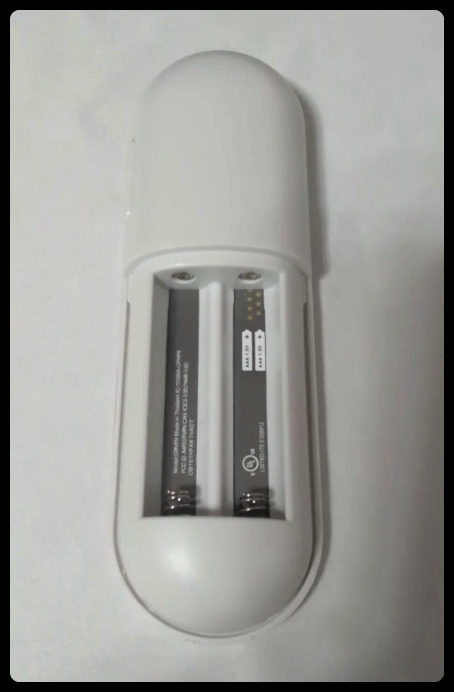

# 通用使用手册

本手册面向“换一台 Mac / 换一个遥控器”的场景。项目不是为某一台机器写死的：
设备通过 VID/PID 或产品名匹配，按键由 HID Report Descriptor 动态解析。

---

## 1. 适用范围（先看这一节）

| 能用 | 说明 |
| --- | --- |
| **macOS 13+**（Intel / Apple Silicon） | App 与命令行都依赖 IOKit / CoreGraphics / AVFoundation |
| **任何 BLE / USB HID 遥控器** | 只要 macOS 在“系统信息 → 蓝牙”或 `hidutil list` 里把它识别为键盘 / Consumer Control，就能映射 |
| **完整实测** | **G9N9N**（Chromecast with Google TV 2020 语音遥控器，`18d1:9450`，17 键 + 语音 + 麦克风） |
| 未逐一实测 | 小米蓝牙语音遥控器、Apple TV Remote、各类 Android TV / 投影仪遥控器——原理相同，用 `learn` 学键即可 |

| 不能用 | 原因 |
| --- | --- |
| **iPhone / iPad** | iOS 不允许第三方 App 做系统级按键注入；遥控器能配对成键盘，但本软件无法在 iOS 上运行 |
| Windows / Linux | 本项目使用 macOS 私有/系统 API；Windows 可参考上游 `windows-remote-mic-app`，Linux 可用 `keyd`/`hid-remapper` |
| 红外-only 遥控器 | 没有蓝牙 HID 连接，系统收不到按键 |

### 1.1 完整支持的具体型号（重要）



图中是 **Chromecast with Google TV Voice Remote（2020）**，电池仓丝印 **G9N9N**，
白色圆角、两节 AAA 电池，VID:PID `18d1:9450`。

| 型号 | 完整支持 | 说明 |
| --- | --- | --- |
| **G9N9N**（图中） | ✅ | 17 键 + 语音键 Fn + 遥控器麦克风（ATVV），全部实测 |
| Google TV Streamer 2024 遥控器 | ❓ | 未实测；按键可能可用，语音/麦克风不保证 |
| ADT-3 / 其它 Chromecast 遥控器 | ❓ | 需 `sniff` / `learn` 验证 |
| 小米 / 其它品牌遥控器 | 部分 | 按键可学；语音键与麦克风链路不同，不保证 |

市面上谷歌遥控器外观相似但固件/HID 描述符/语音通道不同，**不是所有谷歌遥控器都通用**。
购买或替换前请对照电池仓丝印 `G9N9N`；不确定时先用 `sniff` 看有没有 HID 报告、用
`learn` 逐个绑键，语音键则看蓝牙日志里有没有 `0x003F`。

> 本项目与 Google 无关联；Google TV、Chromecast 是 Google LLC 的商标。

---

## 2. 前置条件

- macOS 13+；构建 App 需要 Xcode Command Line Tools：`xcode-select --install`
- Python 3.9+（系统自带 `/usr/bin/python3` 即可，用于命令行/测试）
- 可选：Homebrew（安装 BlackHole 用；没有也能用脚本下载官方 pkg）

## 3. 配对与识别设备

1. 系统设置 → 蓝牙，把遥控器配对并连接。
2. 查看它是不是 HID 设备：

```bash
./bin/gvtv-remote list          # 按配置匹配
hidutil list | grep -i remote  # 系统视角
```

记下 **VendorID / ProductID**（例如 `18d1:9450`）和产品名。

3. 修改配置 `~/.config/gvtv-remote/mapping.json`：

```json
"device": {
  "vendor_id": 6353,
  "product_id": 37968,
  "product": "Chromecast Remote",
  "seize": true
}
```

- 知道 VID/PID：填这两个即可（十进制，`0x18d1 = 6353`）。
- 不知道 VID/PID：把 `vendor_id` / `product_id` 设为 `0`，只填 `product`
  （必须和系统里的产品名完全一致）。
- 同一台 Mac 接多个遥控器：切换配置里的 `device`，重启 App/服务即可。

4. 先确认能收到按键：

```bash
./bin/gvtv-remote sniff --seconds 30
```

按遥控器，终端应打印 `report ... -> c:0x...`。没有输出就检查权限（下一节）。

---

## 4. 权限（macOS 必做）

| 权限 | 用途 | 给谁 |
| --- | --- | --- |
| **输入监控** | 读取遥控器 HID 报告 | App 或你的终端 |
| **辅助功能** | 合成键盘 / 媒体 / Fn 事件 | App 或你的终端 |

App 方式：系统设置 → 隐私与安全性 → 对应页面勾选 **Google TV Remote**。
命令行方式：勾选你用的终端（Terminal / iTerm）。

> App 是 ad-hoc 签名，**重新构建/安装后系统可能要求重新授权一次**；把 App 固定在
> `/Applications` 使用。授权后若仍无反应，重启一次 App。

---

## 5. 安装与启动

### 4.1 原生 App（推荐）

```bash
./scripts/install-app.sh          # 构建并复制到 /Applications
./scripts/install-app-login.sh    # 可选：登录自动打开
```

### 4.2 命令行

```bash
./bin/gvtv-remote doctor          # 体检
./bin/gvtv-remote run             # 前台运行，Ctrl-C 退出
./scripts/install.sh              # 可选：LaunchAgent 常驻
```

> App 与命令行不要同时运行，会争抢“独占”设备。

---

## 6. 按键映射

- App：左侧按键列表 → 右侧选择动作类型（键盘 / 媒体 / App / 网址 / Shell / 文本 / 语音）。
- 命令行学习：

```bash
./bin/gvtv-remote learn                    # 按一下，打印按键 ID
./bin/gvtv-remote learn --bind 'key:cmd+space'
```

- 动作写法：`key:cmd+shift+4`、`media:volume_up`、`app:Safari`、`url:https://…`、
  `shell:…`、`text:…`、`voice`、`none`。
- 未知按键会显示 `usage 0xXX`，用 `learn` 绑定即可；App 的「+」也能添加自定义 usage。

---

## 7. 语音键（Fn / 云键）

语音键映射为 `voice` 动作：按下发 Fn（Globe），松开释放；系统听写或第三方语音输入法
（如 Chatterfly）收到 Fn 后开始/结束录音。

- **按住说话**：`voice.mode = "hold"`（默认，最稳，尤其配合遥控器麦克风）。
- **按一次开/再按一次关**：`voice.mode = "latch"`；需要能持续收到按下沿。
- **按两次 Fn**：`voice.mode = "double"`，适配系统“按两次 Fn”的快捷键。

macOS 设置：系统设置 → 键盘 → 听写 / “按下 🌐 键” → 开始听写；
或在第三方输入法里把语音快捷键设为 Fn。

> Chromecast 遥控器的语音键**不在 HID 报告里**，而是 BLE GATT `0x003F`
> （`04 03 02 xx` / `08` / `00 02`）。本项目通过系统蓝牙日志旁路识别。
> 一旦有其它程序用 CoreBluetooth 订阅了该特征，日志消失、语音键会“失灵”：
> **把 Mac 蓝牙关掉再打开**即可恢复。不要同时跑其它 GATT 调试工具。

---

## 8. 遥控器麦克风（仅部分遥控器）

Chromecast 遥控器的麦克风走 BLE ATVV（GATT `0x003C`，IMA ADPCM，16 kHz），
macOS 不会把它暴露成音频输入。需要三步：

### 7.1 安装虚拟声卡

```bash
./scripts/install-blackhole.sh     # BlackHole 2ch（GPL-3.0，Existential Audio）
# 可选：复制成独立名字 "Google TV 2ch"
./scripts/create-gtv-device.sh
```

### 7.2 启动音频桥

```bash
./scripts/install-mic.sh
# 如果创建了独立声卡：
GVTV_AUDIO_DEVICE="Google TV 2ch" ./scripts/install-mic.sh
```

### 7.3 在输入法里选麦克风

把语音输入法的麦克风选为 **BlackHole 2ch** 或 **Google TV 2ch**，按住遥控器语音键
说话即可。音频桥日志：`~/Library/Logs/RemoteMic.log`。

### 7.4 音频路由（很重要，别把虚拟声卡当扬声器）

虚拟声卡是一条“回环线”，不是扬声器。正确设置：

| 位置 | 应该选 |
| --- | --- |
| 系统设置 → 声音 → **输出** | 真实扬声器 / 耳机（L32p-30、MacBook Pro 扬声器、蓝牙耳机） |
| 系统设置 → 声音 → **输入** | **Google TV 2ch**（或 BlackHole 2ch） |
| 输入法自己的麦克风 | **Google TV 2ch**（或“系统默认”） |

把虚拟设备设为**输出**会把系统声音全部送进这条回环线，听起来就是“没声音/耳机坏了”，
这是设计如此，不是硬件故障。输出保持真实设备即可。

> 系统默认输入是全局的：开视频会议/语音通话时，记得把输入切回 Mac 麦克风，否则对方
> 会听到虚拟麦克风（没有声音）。

音频桥的守护方式（v1.0.3 起）：

- 每 2 秒自检；设备 ID 变化或音频引擎停止时，**进程退出并由 LaunchAgent 重启**，
  用全新的 CoreAudio 连接，避免休眠后旧连接“假活”但没声音；
- 系统唤醒（sleep/wake）时主动重启，并重新检查路由；
- 单实例锁：LaunchAgent 与手动运行不会叠加抢设备；
- 心跳看门狗：主线程卡在 CoreAudio 调用超过 25 秒会退出重启；
- 路由监听：默认输出被改成虚拟声卡、或默认输入被改回 Mac 麦克风时，自动纠正为
  “输出真实设备、输入虚拟麦克风”。

若仍无声：

```bash
launchctl kickstart -k gui/$(id -u)/com.gvtv.remote-mic
tail -20 ~/Library/Logs/RemoteMic.log
```

> 音频桥只针对 ATVV 遥控器（Chromecast / 部分 Android TV 遥控器）。小米等其它型号的
> 麦克风链路不同，需单独适配。没有麦克风需求时完全可以不装 BlackHole。

---

## 9. 常见问题

| 现象 | 处理 |
| --- | --- |
| 终端/日志没有按键 | 输入监控权限；`sniff` 确认；换 USB 口/重连 |
| 有按键但系统没动作 | 辅助功能权限；动作是否 `none`；是否与其它改键软件冲突 |
| 语音键突然失灵 | 蓝牙关/开（清 GATT 订阅会话）；确认没有其它 GATT 客户端 |
| 语音能转文字但电脑没声音 | 系统输出被设成了虚拟声卡；改回真实扬声器/耳机 |
| 虚拟麦克风没声音 | `launchctl kickstart -k gui/$(id -u)/com.gvtv.remote-mic`；看日志是否重新“已启动” |
| 休眠/唤醒后语音失效 | v1.0.2 已自动重启桥并修正路由；若仍失效，`launchctl kickstart -k …` 并附日志 |
| 音量/静音无效 | 先 `test-media volume_up`；仍无效改用 `shell:osascript …` |
| 重新构建 App 后权限失效 | ad-hoc 签名导致，重新勾选一次；固定放在 /Applications |
| 多个遥控器 | 改配置 `device` 后重启；一次只接管一个 |
| 与 UURemote/小米遥控器冲突 | 两条虚拟声卡相互独立；不要同时占用同一个虚拟设备 |

日志：

- App：`~/Library/Logs/GoogleTVRemote.log`
- 麦克风桥：`~/Library/Logs/RemoteMic.log`
- 命令行：终端输出

---

## 10. 卸载

```bash
./scripts/uninstall.sh                        # 命令行 LaunchAgent
launchctl bootout gui/$(id -u) ~/Library/LaunchAgents/com.gvtv.app.plist 2>/dev/null
launchctl bootout gui/$(id -u) ~/Library/LaunchAgents/com.gvtv.remote-mic.plist 2>/dev/null
rm -f ~/Library/LaunchAgents/com.gvtv.app.plist ~/Library/LaunchAgents/com.gvtv.remote-mic.plist
rm -rf "/Applications/Google TV Remote.app"
# 可选：删除虚拟声卡（需要管理员）
sudo rm -rf /Library/Audio/Plug-Ins/HAL/GoogleTV2ch.driver && sudo killall coreaudiod
```

配置在 `~/.config/gvtv-remote/`，可保留。
